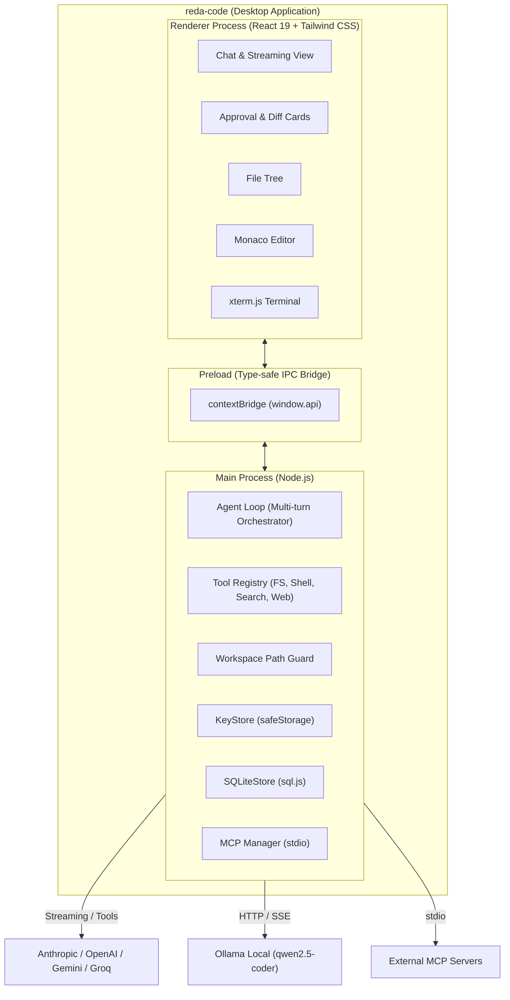

# ⚡ reda-code

> **Desktop AI Coding Agent (Multi-LLM) inspired by Claude Code & Cursor**  
> Native Desktop App (Windows `.exe` + Linux AppImage) powered by Electron, React 19, TypeScript & Tailwind CSS v4.

[](https://github.com/REDA-android/reda-code/actions)
[](https://opensource.org/licenses/MIT)
[](https://www.typescriptlang.org/)
[](https://react.dev/)
[](https://tailwindcss.com/)

---

## ✨ Features

- 🤖 **Multi-Provider LLM Engine**: Seamlessly switch between **Anthropic Claude**, **OpenAI GPT**, **Google Gemini**, **Groq**, and local **Ollama** (e.g. `qwen2.5-coder`).
- 🛡️ **Human-in-the-Loop & Safety First**: Mutating actions (file modification, command execution) require user approval by default, showing a unified visual diff. A one-click **Auto Mode** is available when you want uninterrupted execution.
- 📁 **Unified Workspace**: 3-pane layout featuring:
  - **Left Sidebar**: Session history, quick session switching, persistent state in SQLite, and language switcher (FR/EN).
  - **Central Chat**: Streaming markdown rendering, syntax highlighting, tool execution logs, and interactive diff approval cards.
  - **Right Panel**: Built-in **File Tree**, **Monaco Editor** with multi-language syntax highlighting and save capabilities, and integrated **xterm.js Terminal**.
- 🔌 **Model Context Protocol (MCP)**: First-class client support for stdio MCP servers to connect custom tools and workflows dynamically.
- 🔐 **Encrypted Credentials**: API keys are securely encrypted at rest using Electron's native `safeStorage` (OS keychain).
- 💾 **Pure SQLite Persistence**: Session history and messages stored in a zero-dependency SQLite database powered by `sql.js`.
- 🌐 **Bilingual Interface**: Native support for French (`fr`) and English (`en`).

---

## 🏗️ Architecture



Detailed C4 documentation:
- [C4 Context](docs/architecture/c4-context.md)
- [C4 Container](docs/architecture/c4-container.md)
- [C4 Component](docs/architecture/c4-component.md)

---

## 🚀 Quick Start

### Prerequisites
- [Node.js](https://nodejs.org/) v20 or later
- npm or pnpm
- Git

### Installation

```bash
# Clone the repository
git clone https://github.com/REDA-android/reda-code.git
cd reda-code

# Install dependencies
npm install

# Run in development mode
npm run dev
```

---

## 🛠️ Testing & Verification

```bash
# Typecheck
npm run typecheck

# Linter
npm run lint

# Run all unit tests (Vitest)
npm test

# Run tests in watch mode
npm run test:watch
```

---

## 📦 Packaging & Releases

### Build locally

```bash
# Build production bundles
npm run build

# Package Linux AppImage
npm run build:linux

# Package Windows NSIS (.exe) installer
npm run build:win
```

### GitHub Actions CI/CD
A complete GitHub Actions workflow is provided in [`.github/workflows/build.yml`](.github/workflows/build.yml). Every tag pushed (e.g. `v0.1.0`) automatically builds and publishes the Windows `.exe` installer and Linux AppImage as a GitHub Release.

---

## ⚙️ Configuration

### LLM Providers & API Keys
Click the **Settings** (⚙️) button in the bottom left corner to configure:
- **Anthropic**: Claude 3.5 Sonnet, Claude 3.7 Sonnet.
- **OpenAI**: GPT-4o, GPT-4.1.
- **Gemini**: Gemini 2.5 Flash, Gemini 1.5 Pro.
- **Groq**: Llama 3.3 70B Versatile.
- **Ollama**: Any local model running on `http://localhost:11434/v1` (no API key required).

### Model Context Protocol (MCP)
In Settings, you can configure stdio MCP servers using JSON:

```json
[
  {
    "name": "filesystem",
    "command": "npx",
    "args": ["-y", "@modelcontextprotocol/server-filesystem", "."]
  }
]
```

---

## 📜 License

MIT License — see [LICENSE](LICENSE) for details.
