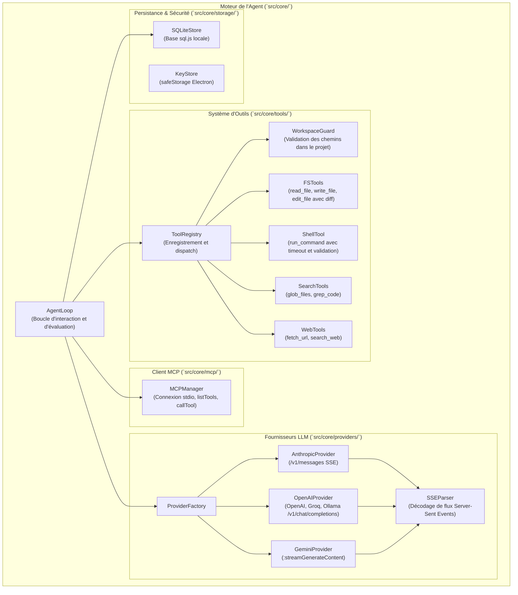

# Architecture C4 — Niveau 3 : Composants du Core Agent

## Description des Composants

- **AgentLoop** : Reçoit la requête utilisateur et l'historique de la session. Interroge le fournisseur LLM sélectionné. Lorsqu'un outil est appelé, vérifie si une approbation est nécessaire (mode auto désactivé ou action sensible comme shell / écriture de fichier). Si approbation requise, suspend l'exécution et émet un événement vers le Renderer. Une fois approuvé, exécute l'outil et réinjecte le résultat au LLM jusqu'à complétion de la réponse.
- **WorkspaceGuard** : Empêche toute tentative de lecture ou d'écriture en dehors du dossier de travail sélectionné par l'utilisateur.
- **ProviderFactory & Providers** : Normalisent les différences entre les APIs Anthropic, OpenAI, Gemini, Groq et Ollama dans un format standardisé de streaming et de tool-calling (`ChatMessage`, `ToolCallPart`, `ToolResultPart`).
- **MCPManager** : Fait le pont entre les serveurs MCP (Model Context Protocol) déclarés dans les réglages et le registre d'outils de l'agent.
