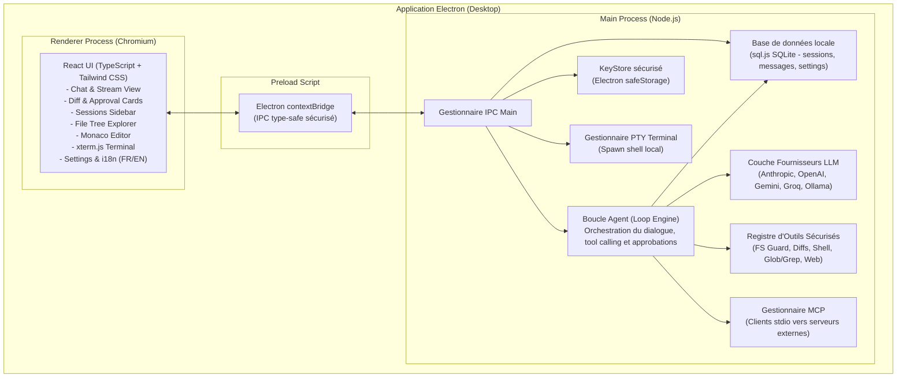

# Architecture C4 — Niveau 2 : Conteneurs

## Description des Conteneurs

1. **Renderer Process** : Interface utilisateur réactive construite avec React 19, TypeScript et Tailwind CSS v4. Gère l'affichage bilingue (i18n), l'état des sessions, le rendu markdown, les cartes d'approbation avec diffs unifiés, l'arbre de fichiers interactif, l'éditeur Monaco et le terminal xterm.js.
2. **Preload Script** : Pont sécurisé isolant le Renderer du Main process via `contextBridge.exposeInMainWorld`, exposant une API IPC typée (`window.api`).
3. **Main Process** : Moteur d'exécution Node.js supervisant l'accès au système de fichiers, l'exécution des commandes, le chiffrement des clés d'API (OS keychain via `safeStorage`), la persistance SQLite (sans binaire natif grâce à `sql.js`), le client MCP et la boucle d'agent.
