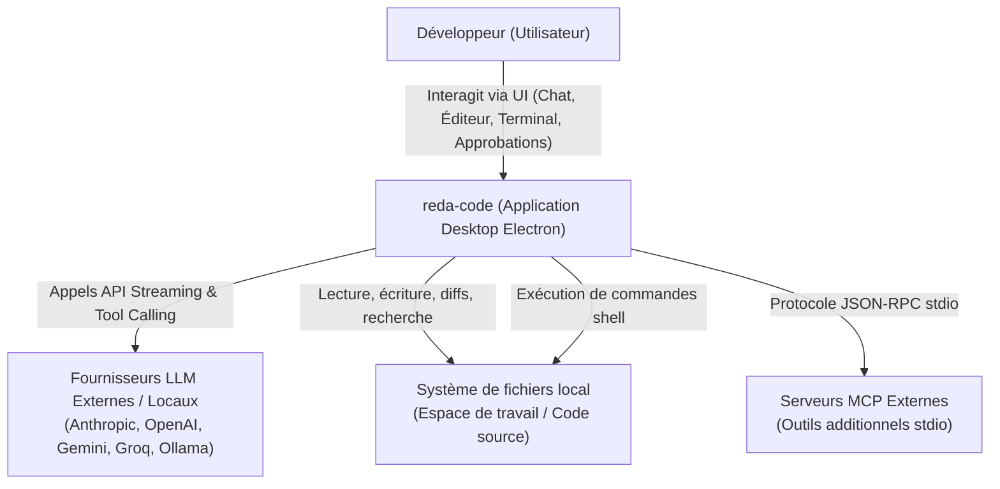

# Architecture C4 — Niveau 1 : Contexte Système

## Description des Acteurs et Systèmes

- **Développeur** : Utilise l'application desktop pour dialoguer avec l'agent de code, superviser et valider les modifications de fichiers ou exécutions de commandes shell.
- **reda-code** : Application desktop Electron (React + TypeScript + Tailwind) intégrant un moteur d'agent IA autonome avec boucle de réflexion, outils sécurisés, persistance SQLite, terminal et éditeur de code.
- **Fournisseurs LLM** : APIs externes sécurisées (Anthropic Claude, OpenAI GPT, Google Gemini, Groq) ou instance locale (Ollama) fournissant les capacités de raisonnement et de génération de code avec tool-calling.
- **Système de fichiers local** : Répertoire de travail restreint (Workspace) sur lequel l'agent opère en toute sécurité avec validation humaine par défaut.
- **Serveurs MCP** : Processus locaux communiquant via Model Context Protocol (stdio) pour étendre les outils de l'agent.
